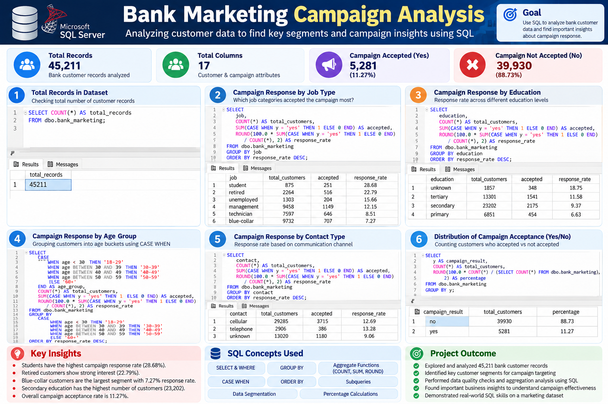

# Bank Marketing Campaign Analysis using SQL Server

## 📌 Project Overview
This project analyzes the Bank Marketing dataset using Microsoft SQL Server to understand customer behavior and evaluate marketing campaign performance.
The project focuses on SQL-based data exploration, data quality checks, customer segmentation, and campaign response rate analysis.

## 📂 Dataset Details
- **Dataset:** Bank Marketing (`bank-full.csv`)
- **Total Records:** 45,211
- **Total Columns:** 17
- **Database:** `banking_sql_project`
- **Table:** `dbo.bank_marketing`

## 🛠️ Tools & Technologies
- Microsoft SQL Server
- SQL Server Management Studio (SSMS)
- SQL

## 🔍 Key Analysis Areas
- Data understanding and NULL value checks
- Identification of unknown and duplicate records
- Customer distribution by job, education, age, and contact method
- Campaign acceptance and response rate analysis
- Customer segmentation using multiple conditions
- CTEs and subqueries
- Window functions: `ROW_NUMBER()`, `RANK()`, `DENSE_RANK()`, `LAG()`, and `LEAD()`
- Views, indexes, and stored procedures
- Data quality validation and query optimization fundamentals

## 🎯 Business Objective
To analyze historical campaign performance, compare customer segments, and identify groups with stronger response rates to support data-driven marketing decisions.

## 💡 Key Learning
This project helped me practice SQL from basic data exploration to advanced analytical techniques and understand how SQL can turn raw data into useful business insights.

## ▶️ How to Use
1. Download the SQL script from this repository.
2. Open SQL Server Management Studio.
3. Select or create the `banking_sql_project` database.
4. Import `bank-full.csv` into `dbo.bank_marketing` if the table is not already available.
5. Review the SQL script and execute the queries in the appropriate order.

## ⚠️ Note
The analysis is based on historical campaign data. Observed response rates describe past behavior and do not guarantee future campaign outcomes.
